# agents

A Go CLI for running Claude Code, Codex, Pi, and OpenRouter Ori inside a Linux VM on a Mac.
Keep your terminal and host applications on macOS, export selected folders to the VM,
and route selected domains through the Mac's network or corporate VPN.



See [Architecture and request flows](docs/architecture.md) for diagrams of routing,
browser access, VM startup, and trusted-network bypass.

## Installation

Requirements: macOS with Lima VZ support, Lima 2.1+, and Go 1.25+ to build.
**VLESS networking requires Lima 2.1.x**; other versions are rejected until the
protected gateway integration has been checked for compatibility.

```sh
brew install lima go
make test
make install
```

This installs two binaries: `agents` for the Mac and `agents-linux-arm64`
(or `amd64`) for the VM. Keep the guest binary next to the host binary, or set
`AGENTS_GUEST_BINARY` to the guest helper executable.

VLESS mode also requires `sing-box` on the Mac, tested with version 1.13.11.
Gateway dependencies are pinned in `go.mod` and `go.sum`.

## Quick start

```sh
agents create                      # 4 CPUs, 8 GiB RAM, 60 GiB disk; initially stopped
agents mounts add "$PROJECT_DIR"    # Export the selected project read/write
agents network add '*.example.com' example.com

# Optional: protect networking before the first boot.
# Requires sing-box; see the VLESS section below.
# agents vpn add --stdin < "$VLESS_FILE"

agents start                       # Install tools and agent CLIs on the first boot

cd "$PROJECT_DIR"
agents claude .
agents codex . --model MODEL
agents codex . login --device-auth
agents pi .
agents ori . pi                   # Run Pi through OpenRouter
agents openrouter . claude        # Alias for agents ori . claude

agents status
agents stop
agents delete                      # Delete VM, guest auth/history, and config; keep host folders
```

Authenticate **inside the VM**, separately for each agent CLI. Host agent
configuration, SSH configuration, credentials, and environment variables are
not copied into agent sessions. Use the CLI's browser login URL or device authentication.
Automatic forwarding of OAuth callback ports is disabled, along with other
automatic guest port forwarding.

On the first `start`, Ubuntu installs git, ripgrep, tmux, jq, Python/venv,
build-essential, official Node 22/npm with archive SHA-256 verification,
Claude/Codex/Pi through npm, and Ori through its official installer, which
verifies release checksums. Pi requires Node 22.19 or newer and is installed
from `@earendil-works/pi-coding-agent` with dependency scripts disabled. This
requires internet access. Missing tools are also installed when an older VM
starts, including a healthy running VM, without recreating its disk or
restarting its sessions. Existing tools are not upgraded automatically.
To update them manually:

```sh
agents shell npm install -g @openai/codex @anthropic-ai/claude-code
agents shell npm install -g --ignore-scripts @earendil-works/pi-coding-agent
agents shell ori update
```

State lives in a private per-user directory. Lima uses a dedicated
`LIMA_HOME`, leaving other Lima environments alone.

```sh
agents --vm work create --cpus 6 --memory 12 --disk 100
agents --vm work codex .
agents --state-dir "$STATE_DIR" status
```

Global flags go **before the command**. `AGENTS_HOME` sets an alternative state
directory. Each VM profile has its own mounts, network/MCP settings, credentials,
and guest disk. All harnesses in the same VM share access to that VM.

## Sessions and arguments

### Browse through the VM from the Mac

```sh
agents socks                       # 127.0.0.1:1080; runs until Ctrl+C
agents --vm work socks --port 1081  # Another VM or local port
curl --noproxy '' --proxy socks5h://127.0.0.1:1080 https://example.com
```

The command starts the VM if necessary and opens an SSH tunnel to **the same
guest SOCKS5 proxy used by agents**. It uses the same `network` split routing,
DNS handling, and default VM egress: VLESS, trusted-network bypass, or ordinary
Lima networking. Hostnames travel into the VM; corporate exceptions resolve on
the Mac, just as they do for agent requests.

There is no direct fallback on the Mac if the tunnel fails. An occupied local
port produces an error. Ctrl+C closes this tunnel while leaving the VM and
agent sessions running. After stopping or restarting the VM, run `agents socks`
again.

Configure the browser to use SOCKS5 at `127.0.0.1:1080` with DNS through SOCKS.
For example, select manual configuration and SOCKS v5 in
[Firefox connection settings](https://support.mozilla.org/en-US/kb/connection-settings-firefox),
and keep [SOCKS v5 DNS resolution through the proxy](https://firefox-admin-docs.mozilla.org/reference/policies/proxy/).
The command does not change macOS system proxy settings. Browser cookies,
logins, and profiles remain separate: matching network access does not copy an
agent's authenticated session.

To reach services on `localhost` **inside the VM**, the browser must send
loopback addresses through the proxy too. Chrome bypasses them by default.
For a separate Chrome profile suitable for inspecting a guest web application:

```sh
open -na 'Google Chrome' --args \
  --user-data-dir="$BROWSER_PROFILE" \
  --proxy-server='socks5://127.0.0.1:1080' \
  --proxy-bypass-list='<-loopback>' \
  --host-resolver-rules='MAP * ~NOTFOUND, EXCLUDE 127.0.0.1'
```

See Chromium's documentation for [SOCKS and DNS](https://www.chromium.org/developers/design-documents/network-stack/socks-proxy/)
and [loopback bypass rules](https://chromium.googlesource.com/chromium/src/+/HEAD/net/docs/proxy.md).
In this profile, `http://127.0.0.1:3000` refers to the VM.

The proxy supports TCP CONNECT. It provides website access, not whole-browser
isolation: UDP/WebRTC and requests outside the browser's proxy configuration are
not covered. The local listener has no password and is accessible to processes
on the Mac, but not other machines on the LAN. Close it when no longer needed.
See the [browser request diagram](docs/architecture.md#browser-access).

### Terminal and agent CLIs

```sh
agents claude . --resume
agents codex "$PROJECT_DIR" exec 'run the tests'
agents codex . -- exec 'argument with spaces; $(this is literal)'
agents ssh
agents ssh git --version
agents --vm work ssh
```

`agents ssh` starts the VM if necessary and opens an interactive Bash session
over SSH. Arguments after the command execute inside the VM. For shell
expressions, use `agents ssh bash -lc 'pwd && ls'`. Proxy environment variables
and the managed `CODEX_HOME` are loaded automatically. `agents shell` is an alias.

The first argument after `claude`, `codex`, `pi`, `ori`, or `openrouter` is a
folder on the Mac. The wrapper
mounts it if necessary, starts the VM, and runs the agent in that directory.
Remaining arguments are forwarded as supplied to the wrapper, without another
local shell evaluation. One optional `--` immediately after the folder is
removed. The agent's exit code is propagated to the caller. SSH allocates a TTY
in an interactive terminal, preserving the normal agent terminal UI.

Starting another session in a running VM does not restart the proxy or other
sessions. `agents stop` stops all VM processes. Sessions connect directly over
SSH; there is no automatic tmux or reconnect. For long sessions, use
`agents shell tmux new -A -s work` and start the agent manually inside the VM.

### Pi and OpenRouter Ori

```sh
agents pi .
agents pi . --provider openrouter --model PROVIDER/MODEL
agents pi . auth login openrouter --api-key  # Prompt for a key inside the VM
agents pi . mcp list --json

agents ori . --help
agents ori . login
agents ori . login --with-key     # Prompt for an API key inside the VM
agents ori . pi --model PROVIDER/MODEL
agents ori . claude --model PROVIDER/MODEL
agents ori . codex --model PROVIDER/MODEL
agents openrouter . pi                      # Alias for ori
```

Pi is a standalone coding harness. Ori is the official OpenRouter CLI that
launches another harness with OpenRouter configured; select the harness after
the directory, for example `agents ori . pi`. Other Ori commands, including
login, help, and update, run inside the VM too. Ori may offer to install other
harnesses; only Claude, Codex, and Pi are installed by default by this wrapper.

Pi uses a separate managed `PI_CODING_AGENT_DIR` inside the VM. The wrapper generates
its `mcp.json` from `agents mcp`, preserving Pi's authentication, settings, and
sessions. Native MCP integration targets current Pi releases (tested version
is recorded below); an older manually installed Pi may need updating. Trusted
project configuration can still add or override capabilities.

Ori stores its own account state inside the VM. For Ori sessions, the wrapper
sets a separate managed `CODEX_HOME`, because Ori
can change Codex authentication while configuring OpenRouter. Ordinary
`agents codex` credentials remain in the regular managed Codex home.
`ori claude` receives the managed Claude MCP flags; `ori codex` and `ori pi`
use their managed guest configuration. Use `agents mcp` for entries the wrapper
manages; edits to generated MCP files are replaced on the next session.

All launchers receive the guest proxy environment. Authenticate in the guest;
host keys are not forwarded. OAuth flows that redirect to guest localhost
need a browser path to that guest callback, such as the
[browser SOCKS setup](#browse-through-the-vm-from-the-mac); automatic OAuth
port forwarding remains disabled. API-key and remote-login choices depend on
the selected CLI and provider.

Upstream: [Pi](https://github.com/earendil-works/pi/tree/main/packages/coding-agent),
[Pi MCP](https://github.com/earendil-works/pi/blob/main/packages/coding-agent/docs/mcp.md),
[Ori Harness](https://openrouter.ai/docs/guides/ori/harness).

## Folders

```sh
agents mounts list
agents mounts add "$HOST_DIR"                 # Default guest destination, RW
agents mounts add "$HOST_DIR" "$GUEST_DIR" --ro
agents mounts remove "$HOST_DIR"
```

The default destination uses the source folder name under the managed guest
project root. Relative destinations are resolved under that root. The CLI
prints the selected mapping and accepts only designated guest mount roots
to protect guest tools.
Overlapping mounts and duplicate destinations are rejected. Running an agent
in a subdirectory of an exported folder reuses the existing mount. To change
RO/RW mode, remove the mount and add it again.

**Changing virtiofs mounts requires a VM restart.** By default, the command
refuses to interrupt a running VM. Stop it first, or explicitly allow a restart:

```sh
agents --restart claude "$PROJECT_DIR"
agents mounts add "$HOST_DIR" --restart
agents mounts remove "$HOST_DIR" --restart
```

A restart ends **all** current sessions in that VM. Exports persist across
starts until removed with `mounts remove`. Writing to an RW mount changes the
original files on the host. An RO mount prevents writes but allows reading all
files within the exported tree, including hidden files.

## Selected routes through the Mac

```sh
agents network
# network> + *.example.com
# network> + git.corp.example
# network> - git.corp.example
# network> list
# network> quit

agents network add '*.example.com' example.com git.corp.example
agents network remove git.corp.example
agents network list
```

The `network` list controls **split routing** through an application proxy:

- Matching hostname: guest proxy → SSH tunnel → Mac SOCKS5 → Mac network/VPN.
- Other hostnames: VM networking, using VLESS, trusted-network bypass, or ordinary
  Lima networking according to the VM configuration.
- Matching hostnames resolve on the Mac; the original name is sent over SOCKS5.
- `*.example.com` includes subdomains at any depth, but **not** `example.com`.
- Rules accept hostnames or IP addresses, not URLs, ports, or arbitrary globs.
- An allowed name grants access to **all its TCP ports** through the host proxy.
- Updates apply immediately to **new** connections. Removing a rule does not
  close existing connections.
- This application proxy supports TCP only; it does not provide UDP through the
  Mac. The separate VLESS gateway described below covers TCP, UDP, and DNS for
  the VM's network interface.

Agent sessions and child commands receive `HTTP_PROXY`, `HTTPS_PROXY`,
`ALL_PROXY`, and their lowercase variants. HTTP CONNECT also supports clients
that do not use SOCKS directly. `localhost`, `127.0.0.1`, and `::1` are excluded
through `NO_PROXY`. Programs that ignore proxy environment variables use VM
networking: they are still subject to the VLESS gateway when configured, but do
not use `network` exceptions. SSH/Git over SSH may need a separate
`ProxyCommand`; Git over HTTPS can use the HTTP proxy.

In the guest, HTTP listens on `127.0.0.1:18080` and SOCKS5 on
`127.0.0.1:18082`. Host endpoints are available through SSH reverse forwarding
at `127.0.0.1:18083` for SOCKS and `127.0.0.1:18084` for the read-only policy.
On the Mac, these servers use random loopback ports, require a token, and
recheck the allowlist. The token permits using the list, not changing it.

If policy retrieval fails, the guest proxy returns an error without a direct
fallback. Other programs' raw connections are subject to the VM's configured
network path. See the [routing diagram](docs/architecture.md#outbound-routing).

**Without `agents vpn`**, ordinary Lima networking can inherit host VPN routes
and reach services on the Mac. Lima 2.1 default user networking also provides
host-loopback access. Without VLESS, this wrapper **does not block** those paths
or promise that listed names are the only addresses reachable from the VM.
The host SOCKS proxy blocks loopback, link-local, multicast, and unspecified
destinations; host MCP access uses a separate explicit tunnel.

Host-routed connections are recorded in the selected VM's proxy log.
The log records hostnames and ports, not request contents or tokens.

## VLESS for the whole VM and a kill switch

```sh
brew install sing-box
agents create
agents vpn add --stdin < "$VLESS_FILE"
agents start
agents vpn status
agents status

agents stop
agents vpn update --stdin < "$VLESS_FILE"
agents start

# Or explicitly restart a running VM, ending all of its sessions:
agents --restart vpn update --stdin < "$VLESS_FILE"

agents stop
agents vpn delete       # Intentionally restore ordinary Lima networking
```

You can pass the URI as an argument: `agents vpn add 'vless://…'`. Using
`--stdin` keeps the secret out of shell history and process arguments. The
configuration is stored with mode `0600` in the private state directory;
status output omits UUIDs and keys. Set
`AGENTS_SING_BOX` to select a binary. Existing VPN
clients on the Mac and router settings are not modified.

Supported VLESS transports are TCP/raw, WebSocket, gRPC, HTTP, and HTTPUpgrade,
with TLS or REALITY, including `sni`, `fp`, `pbk`, `sid`, `alpn`, `serviceName`,
and Vision for TCP. Unsupported parameters, such as XHTTP, are rejected.
TLS verification is not disabled. The installed `sing-box` validates the
generated configuration when the profile is added or updated.

A VPN-enabled VM has **one network interface**, connected to a dedicated gateway
on the Mac. The gateway starts **before the VM boots**, replacing Lima's normal
unrestricted network interface. By default, TCP/UDP is forwarded only through
the local VLESS client's SOCKS endpoint, with no direct outbound or fallback
to the Mac's network. This covers provisioning, processes with `sudo`, and
programs that ignore proxy environment variables.

Guest DNS uses DoH through Cloudflare, then Google, over VLESS, with no system
DNS fallback. Arbitrary UDP, including DNS sent to a specified IP address,
also uses VLESS. IPv6 and external ICMP are blocked, so `ping` is not a VPN
connectivity test. A configured [trusted-network bypass](#direct-access-on-a-trusted-home-network)
explicitly changes TCP/UDP and DNS egress to direct access.

In VLESS mode, a dead client, broken tunnel, or failed gateway blocks ordinary
external traffic. `vpn status` reports process state and **does not** treat a
running process as proof that the remote server is reachable. After the client
process dies, recover with `agents stop` followed by `agents start`. SSH remains
available while the gateway is alive. If the gateway itself dies, SSH over the
virtual network may also become unavailable.

`agents network` remains an **explicit exception**: matching domains sent through
the guest proxy use the Mac's network and can work while VLESS is unavailable.
Enabled `mcp --host` tunnels remain exceptions too. A raw connection to the same
IP does not use a `network` exception; it follows the default VM egress policy.
Host tools that execute code retain their host application's permissions.

The host may connect to the VLESS server and resolve **that server's** hostname
using the Mac's DNS. This bootstraps the tunnel; it does not resolve guest
queries outside it. If a VPN already runs on the router, VLESS is carried
inside that path. The wrapper does not change router routing. To diagnose a
nested-tunnel problem, compare with a router-side direct route to the VLESS
server where available.

The protected gateway integration requires **Lima 2.1.x**. It also prevents
Lima's ordinary usernet from starting automatically after the custom gateway
fails: the dedicated network's `leases.json` is a symlink to `/dev/null`, so
Lima cannot read leases and enable an unrestricted fallback. This guard survives
VM shutdown and Mac reboot. Do not change it manually. Manage the VM through
`agents`; running `limactl` without the custom gateway is expected to fail with
`failed to start usernet … EOF`.

For protection from the **first boot**, add VPN after `create` and before the
first `start`. Enabling it on an existing running VM requires stopping the VM
or using `--restart`. Removing VPN intentionally restores ordinary networking.
Partial configuration failures preserve the intent to use VPN, preventing the
next start from silently opening direct access.

The selected VM's VPN log records client and gateway output.
See the [startup sequence](docs/architecture.md#vm-startup-and-shutdown).

### Direct access on a trusted home network

While at home, save the current network for the selected VM:

```sh
agents vpn bypass current          # Show the Mac's network; no VM config required
agents vpn bypass add home         # Remember the current network
agents vpn bypass list
agents vpn status                  # Show effective egress and VPN process state
agents vpn bypass delete home      # Require VLESS at home again
```

Rules live in the VM configuration's `vpn_bypass` field and survive
`vpn update`. They are inactive when VPN is disabled. Adding or deleting a
rule updates the running gateway without restarting the VM. On startup, the
gateway checks the network **before the VM attaches**.

A trusted network matches its IPv4 subnet, gateway IP, and gateway MAC;
matching `192.168.x.0/24` alone is not enough. Ethernet and Wi-Fi can share a
rule when all three match. If they use different gateways, save separate rules.
After replacing the router, delete the old rule and learn the network again.

On a match, ordinary TCP/UDP and guest DNS use the Mac's network without the
wrapper's additional VLESS tunnel. A VPN on the home router still applies.
`network` and MCP exceptions remain available; IPv6 and external ICMP remain
blocked. The protected network interface remains the VM's only interface.
The VLESS client stays running for use away from home; its unavailability does
not prevent direct access while the home rule matches. On another network or
when detection fails, egress uses VLESS with its kill switch.

The network is checked before each new connection and approximately once per
second. A network or mode change closes old connections and cancels pending
connection attempts. Direct sockets are bound to the observed IPv4 address and
Mac interface. Applications may need to retry requests.

Detection has a two-second timeout. Switching is **not atomic with OS route
changes**: an existing connection may remain open until the change is detected,
including roaming on the same interface. Subnet/IP/MAC matching recognizes a
trusted LAN; it is not cryptographic authentication and can be spoofed. Do not
add bypass rules if you require an unconditional prohibition on direct packets
during every possible roaming transition.

In direct mode, guest DNS still uses DoH; the DoH providers' own hostnames are
resolved using the Mac's system DNS. See the [bypass state diagram](docs/architecture.md#trusted-network-switching).

## MCP servers

```sh
# stdio: the server process and its tools run inside the VM
agents mcp add SERVER_NAME -- SERVER_COMMAND ARGUMENTS

# Remote Streamable HTTP MCP
agents mcp add SERVER_NAME --url "$REMOTE_MCP_URL"

# An existing server on the Mac; use its actual loopback URL
agents mcp add SERVER_NAME --url "$HOST_MCP_URL" --host

agents mcp list
agents mcp disable SERVER_NAME
agents mcp enable SERVER_NAME
agents mcp remove SERVER_NAME
```

`--host` opens an SSH tunnel to the specified loopback TCP port on the Mac.
It grants access to **the entire port**, not just the URL path or selected MCP
tools. The wrapper neither installs nor starts the host server. HTTP(S)
endpoints and stdio are supported; legacy SSE, arbitrary headers, and host
credential imports are not. Install stdio server programs inside the VM.

The host daemon notices tunnel changes in approximately one second and
reconnects the shared SSH tunnel; existing proxy/MCP connections may close.
Agent MCP configuration changes take effect in a new session.

Claude starts with `--strict-mcp-config` and generated JSON. Codex uses a separate
managed `CODEX_HOME`: credentials and history persist,
while the wrapper generates `config.toml`. Pass other Codex settings through
`-c key=value`. This prevents old MCP entries from ordinary
user configuration from silently surviving table merges. Agent project
settings, plugins, and actions can still add capabilities inside the VM;
this registry is not an enforcement mechanism for agent behavior.

**Host execution:** an MCP tool that runs code, or writable files consumed by
a host application, can execute with that application's permissions. The VM
does not contain that host execution. `agents status` calls out this boundary.

## Isolation boundaries

There is no automatic home mount, SSH-agent forwarding, SSH public-key import,
host authentication copy, arbitrary guest port forwarding, or Docker socket
export. The wrapper's state directory and its ancestors cannot be exported
through `mounts`. Host management sockets are not forwarded into the VM.
State mutations use a file lock; configuration is replaced atomically with
mode `0600`.

The guest is trusted only within the VM: its Lima user has `sudo`, and an agent
can change guest settings. The filesystem boundary is the VM and the explicit
export list, not a prompt, `AGENTS.md`, or a guest firewall. RW folders, files
executed by host applications, allowed host network access, and explicit MCP
access are real exceptions to that boundary.

The [access table](docs/architecture.md#access-boundaries) summarizes each grant.

## Development and verification

```sh
make test     # Race detector, loopback unit/integration tests, and go vet
make build
./bin/agents help
```

Tests cover wildcard boundaries, mount validation, argument quoting, locks,
interactive policy updates, SOCKS authentication/CONNECT/UDP rejection,
HTTP proxying and buffered CONNECT data, live routing changes, and the absence
of direct fallback when policy is unavailable. VPN tests cover VLESS parsing
and redaction, TCP/UDP through the gateway forwarders, DNS failure without a
tunnel, preservation of VPN intent after errors, extra-NIC rejection, and the
Lima fallback guard.

[`scripts/smoke.sh`](scripts/smoke.sh) creates a temporary real Lima VM, checks
the CLI, RW/RO mounts, proxy, and lifecycle, then deletes it. It downloads Ubuntu
and packages, so it needs internet access and takes several minutes.

`python3 scripts/smoke-socks.py` checks browser SOCKS on a separate VM: guest
localhost, hostname requests through SOCKS, HTTPS, port conflicts, the kill
switch, live `network` exceptions, and Ctrl+C tunnel shutdown. It uses an
unreachable test VLESS endpoint and a current-LAN bypass rule only in the test
VM. Lima 2.1.x and sing-box are required. The VM is deleted after the test.

`python3 scripts/smoke-harnesses.py` provisions all default CLIs, checks their
version/help commands and the OpenRouter alias, exercises Pi MCP with a local
test server, and reinstalls missing Pi/Ori tools into a running VM. It makes no
model requests and does not sign into an account. The temporary VM is deleted
after the test.

Diagrams are checked-in SVGs with Mermaid sources. See
[updating the diagrams](docs/architecture.md#updating-the-diagrams) to regenerate them.

### Recorded VM checks

The harness smoke test passed on macOS arm64 with Claude Code 2.1.325,
Codex 0.169.0, Pi 1.5.2, and Ori 0.17.0. It verified the `openrouter` alias,
Pi's managed MCP configuration and guest environment, removal of a disabled
MCP server, and installation of missing Pi/Ori binaries in a running VM
without a reboot or loss of existing state. Authentication and model requests
were not exercised.

On Lima 2.1.1 / macOS arm64, a local test VLESS server supported initial package
installation, a 5 MB download, raw UDP DNS, and gateway DNS. After SIGKILL of the
client, raw TCP from root failed, UDP DNS timed out, and gateway DNS returned
SERVFAIL; `network` and host MCP exceptions remained available. After SIGKILL
of the gateway and VM shutdown, a direct `limactl` start could not launch the
ordinary usernet because of the EOF guard. These checks validate the isolation
mechanism; a particular remote VLESS service also depends on its server and
network path.

In a separate bypass test VM, an unreachable VLESS server did not prevent
initial package installation, HTTPS, raw UDP DNS, or gateway DNS while the
home rule matched. Deleting the rule blocked raw TCP; adding it back restored
access without restarting. After SIGKILL of the VLESS client, home access still
worked, traffic without the home rule remained blocked, and SSH stayed usable.
Automated tests also check periodic network-change detection, TCP/UDP closure,
cancellation of pending connections, and failure to identify the network.
Physical roaming between networks was not tested in that run.

The real-VM SOCKS test verified guest localhost rather than the Mac's localhost,
remote hostname/HTTPS requests, occupied-port rejection, VPN kill-switch
behavior, live host-route exceptions, and closing the listener with Ctrl+C
while the VM remained running.

### Upstream references

- [Lima mounts](https://lima-vm.io/docs/config/mount/)
- [Lima networking](https://lima-vm.io/docs/config/network/user/)
- [Claude network configuration](https://code.claude.com/docs/en/network-config)
- [Claude MCP configuration](https://code.claude.com/docs/en/mcp)
