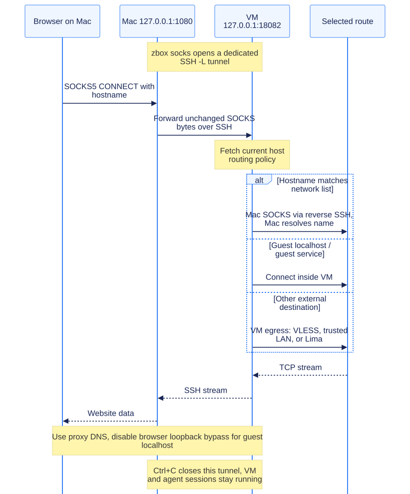
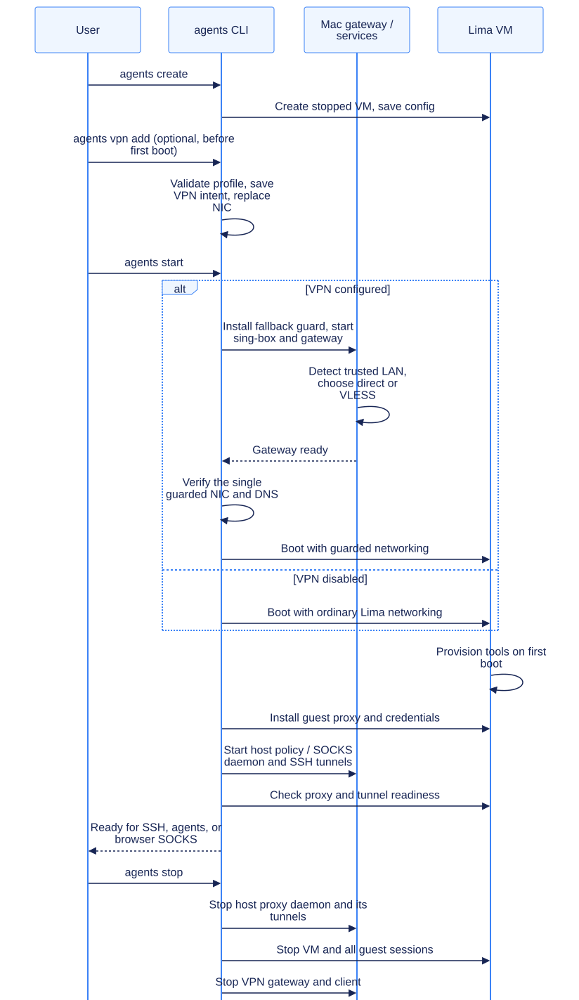

# Architecture and request flows

[Back to the user guide](../README.md)

`zbox` keeps the agent processes in a Lima Linux VM and the interaction
surface on the Mac. Files, host routes, and MCP ports are separate explicit
grants. This page describes the implemented paths, including their limits.

## Components and ownership



The VM is the filesystem isolation boundary. All agent CLIs share the guest
user and can obtain `sudo` inside it. The host CLI controls Lima, virtiofs
exports, SSH sessions, and generated agent configuration. Host applications
run outside the VM, so code they execute retains their host permissions.

The host network services have two distinct jobs:

| Component | Runs on | Responsibility |
| --- | --- | --- |
| `zbox` CLI | Mac | Lifecycle, configuration, mounts, sessions, and status |
| Guest helper, the guest proxy service | VM | HTTP/SOCKS split routing using the current host policy |
| Host proxy daemon | Mac | Authenticated allowlisted SOCKS, read-only policy, and reverse SSH tunnels |
| Guarded gateway | Mac, when VPN is configured | The VM's only NIC, TCP/UDP forwarding, DNS, and prevention of ordinary-network fallback |
| `sing-box` | Mac, owned by the gateway | Local authenticated SOCKS backed by a VLESS outbound |
| Trusted-network router | Inside the Mac gateway | Choose VLESS or an explicit LAN bypass; close flows after detected changes |
| Browser SSH tunnel | Mac, while `zbox socks` runs | Forward a loopback listener to the existing guest SOCKS proxy |

[Mermaid source](diagrams/architecture.mmd)

## Outbound routing



This diagram describes **external connections**. Guest-local services remain
inside the VM. The application proxy supports TCP CONNECT, while raw TCP/UDP
uses the VM interface. The gateway drops IPv6 and external ICMP in VPN mode.
It also rejects loopback, link-local, multicast, unspecified, and gateway-subnet
destinations in its generic forwarders; it is not a blanket private-LAN filter.

There are two different kinds of exception:

- `zbox network` selects destination names that may use the Mac's network.
  It only applies when a program uses the guest HTTP/SOCKS proxy. The host
  rechecks the allowlist, and a failed policy fetch or denied host route never
  retries through a different path. It can continue working while VLESS is down.
- `zbox vpn bypass` identifies the Mac's current LAN. A match changes the
  gateway's ordinary egress for the whole VM to direct TCP/UDP. It does not add
  an unrestricted second NIC. Programs that ignore proxy settings are covered.

With VPN disabled, Lima uses its ordinary network. The `network` list still
selects host-proxy routes but does not restrict other VM connections.
With VPN enabled, failure of the custom gateway blocks the VM's external
network, and the Lima fallback guard prevents replacement by ordinary usernet.

### DNS follows the selected path

| Request | Where name resolution happens |
| --- | --- |
| Proxy request matching `network` | Mac resolver, after the host proxy checks the name |
| Other guest request with VLESS egress | Guest DNS to the gateway, then DoH through VLESS |
| Other guest request with trusted-LAN bypass | Guest DNS to the gateway, then DoH directly through the Mac |
| Raw UDP DNS to an explicit IP | Forwarded through the gateway's selected TCP/UDP egress policy |
| VLESS server bootstrap | Mac resolver for the VLESS server's own hostname |
| DoH provider bootstrap in direct mode | Mac resolver for the provider's own hostname |
| VPN disabled | Ordinary guest/Lima resolver path |

The gateway tries Cloudflare DoH, then Google DoH. If both fail, it returns
SERVFAIL rather than falling back to host DNS for the guest query. Guest tools
can implement their own resolution; their network traffic still follows the
configured interface and proxy paths.

[Mermaid source](diagrams/routing.mmd)

## Browser access



`zbox socks --port 1080` forwards Mac `127.0.0.1:1080` to guest
`127.0.0.1:18082` over a dedicated SSH connection. It uses **local forwarding
(`ssh -L`)**, not dynamic forwarding (`ssh -D`), because a dynamic SSH proxy
would bypass the guest proxy's domain policy.

Send hostnames over SOCKS (`socks5h://` in curl). To open a guest-local web
service, the browser must also proxy loopback URLs rather than applying its
normal localhost bypass. A request to `127.0.0.1:3000` then reaches port 3000
inside the VM, not port 3000 on the Mac. The guest proxy still needs the host
policy service to be available before opening a connection.

The browser tunnel does not share Lima's persistent SSH control master.
Ctrl+C closes its listener and connections without stopping the VM or the
infrastructure's reverse tunnels. An occupied port fails explicitly. Browser
cookies and credentials remain separate, and traffic outside browser proxy
settings, such as direct UDP/WebRTC, is outside this tunnel's scope.

[Browser setup commands](../README.md#browse-through-the-vm-from-the-mac) ·
[Mermaid source](diagrams/browser.mmd)

## VM startup and shutdown



`create` leaves the VM stopped. To protect initial provisioning too, configure
VPN before its first `start`. With VPN configured, the gateway determines the
egress policy and becomes available before the guest can attach its NIC.

The single NIC and guest DNS configuration are verified. The dedicated Lima
network's `leases.json` points to `/dev/null`; on supported Lima 2.1.x versions,
this prevents automatic startup of the ordinary unfiltered usernet if the
custom gateway is gone. Enabling/updating VPN saves the protective intent
before editing Lima configuration. Removing it retains that intent until Lima
has accepted ordinary networking on the stopped VM.

Later sessions reuse a healthy running VM and its proxy infrastructure.
Changing mounts or the VPN profile requires a stopped VM or explicit
`--restart`, which ends all sessions. Network rules and trusted-LAN exceptions
can be edited while the VM runs.

| Change | When it applies | Connection effect |
| --- | --- | --- |
| `network` add/remove | Next proxied connection | Existing connections stay open |
| `vpn bypass` add/delete | Immediate refresh when acknowledged; otherwise next gateway check/start | An effective mode/network change closes gateway flows |
| Detected host network change | Before a new gateway dial or on periodic checks | Existing gateway flows close; pending dials are canceled |
| Host MCP add/enable/disable/remove | Host daemon notices in about one second | Shared reverse SSH tunnel reconnects; proxy/MCP streams may close |
| Agent MCP configuration | Next agent session | Existing agent session configuration stays as it was |
| Mount or VPN profile change | VM restart | All VM sessions end |
| Ctrl+C in `zbox socks` | Immediately | Only that browser tunnel closes |

[Mermaid source](diagrams/startup.mmd)

## Trusted-network switching



The state diagram applies when VPN is configured and the gateway is running.
`Blocked` describes ordinary external egress: explicit `network` and host MCP
exceptions can remain available. If the gateway itself dies, the VM loses its
network path; it cannot switch to direct egress merely because the Mac is home.

A LAN rule matches **IPv4 subnet + gateway IP + gateway MAC**. Runtime tracking
also observes the interface and source address, so a change to either closes
old gateway flows even on the same trusted LAN. Direct sockets bind to that
interface and address. The VLESS client remains available for a later departure
from home; if its process has died, recovery requires stopping and starting the
VM. A running process alone does not prove remote reachability.

Detection runs before new gateway connections and approximately every second,
with a two-second detection timeout. It is **not an atomic OS routing barrier**:
old connections may remain open until a network change is detected. Network
identifiers can also be spoofed. Leave the bypass list empty if these limits do
not meet your roaming isolation requirements.

[Trusted-network commands](../README.md#direct-access-on-a-trusted-home-network) ·
[Mermaid source](diagrams/bypass.mmd)

## Access boundaries

| Grant | What the agent can access | Boundary or limitation |
| --- | --- | --- |
| No folder export | Guest filesystem | No automatic host home or Docker socket mount |
| RO folder export | Every readable file in that tree, including hidden files | No writes through that export |
| RW folder export | Original host files in the exported tree | Host applications may execute modified files |
| `network` name/IP | All TCP ports on matching destinations through the Mac proxy | No URL/path restriction; no generic host loopback/link-local access |
| Host HTTP MCP | One explicitly selected Mac loopback TCP port | Entire port, not just the MCP path or selected tools |
| Guest stdio MCP | A server process running inside the VM | Shares guest privileges and granted exports |
| Remote HTTP MCP | Configured remote endpoint | Transport follows the client's proxy/network behavior |
| Host tool execution or writable host project | Potential execution in a host application | Such code retains that application's host permissions |
| Host browser SOCKS | Same guest proxy routing, including guest-local services | Local Mac processes can use its unauthenticated loopback listener |
| Host management sockets | Configuration and infrastructure control | Not forwarded into the VM |

The guest user has `sudo`. A guest firewall, prompt, or agent configuration is
not the security boundary. The Mac controls folder exports, the host route
allowlist, and the optional protected network interface. The MCP registry
configures Claude, Codex, and Pi sessions (including their Ori launchers); it does not prevent an agent from configuring additional
tools inside the VM.

### Ports and state

All addresses below are loopback addresses unless stated otherwise.

| Location | Endpoint | Purpose |
| --- | --- | --- |
| Mac | `127.0.0.1:1080` by default | Optional `zbox socks` browser listener; `--port` overrides it |
| VM | `127.0.0.1:18080` | Guest HTTP/CONNECT proxy |
| VM | `127.0.0.1:18082` | Guest SOCKS5 proxy |
| VM | `127.0.0.1:18083` | Reverse SSH forwarding to authenticated Mac SOCKS |
| VM | `127.0.0.1:18084` | Reverse SSH forwarding to authenticated read-only host policy |
| VM | `127.0.0.1:19000–19999` | Allocated reverse tunnels for host MCP ports |
| Mac | Random loopback ports | Host SOCKS/policy and the gateway-owned VLESS client's SOCKS |
| Protected virtual network | `192.168.105.2` | Gateway and guest DNS, not a Mac LAN listener |
| Mac filesystem | Private Unix sockets | Host daemon shutdown and gateway management |

VM profiles and Lima state live in separate private locations under the
configured state directory. `config.json` holds the grants and VPN profile with mode
`0600`. `proxy.log` records host-route destinations; `vpn.log` records gateway
and VLESS-client output. Credentials and private VLESS URIs do not belong in
diagram sources or examples.

## Implementation map

| Source | What it implements |
| --- | --- |
| [`internal/app/vm.go`](../internal/app/vm.go) | Lima templates, mounts, provisioning, sessions, and lifecycle |
| [`internal/app/daemon.go`](../internal/app/daemon.go) | Host policy/SOCKS, allowlist enforcement, and reverse tunnels |
| [`internal/guest/guest.go`](../internal/guest/guest.go) | Guest HTTP/SOCKS proxy and split-routing decisions |
| [`internal/app/harnesses.go`](../internal/app/harnesses.go) | Shared initial installation, missing-tool migration, and Ori launch handling |
| [`internal/app/socks.go`](../internal/app/socks.go) | Browser tunnel arguments and local port validation |
| [`internal/app/vpn.go`](../internal/app/vpn.go) | VPN configuration, guarded startup, client ownership, and health |
| [`internal/gateway/gateway.go`](../internal/gateway/gateway.go) | Virtual NIC, TCP/UDP forwarding, DNS, and local management API |
| [`internal/hostnet`](../internal/hostnet) | Trusted-LAN detection, matching, egress switching, and flow cancellation |
| [`internal/vpn/profile.go`](../internal/vpn/profile.go) | VLESS parsing and sing-box configuration generation |
| [`internal/app/mcp.go`](../internal/app/mcp.go) | MCP registration and generated agent configuration |

## Updating the diagrams

The `.mmd` files in [`diagrams/`](diagrams/) are the editable Mermaid sources.
The `.svg` files are rendered artifacts used by this page and the README, so
viewers do not need a Mermaid plugin. Labels and their surrounding explanations
are in English. Keep sources and SVGs together when changing a diagram.

With Mermaid CLI available as `mmdc` (rendered with 11.12.0), run this from the
repository root:

```sh
python3 scripts/render-diagrams.py
```

The script uses an installed Chrome when available,
or Mermaid CLI's installed headless browser. `PUPPETEER_EXECUTABLE_PATH` can
override the browser executable. It renders with the shared configuration,
preserves SVG text spacing across viewers, and adds a white background.

Render and inspect all changed diagrams, check local links, and compare routing
or lifecycle changes with the implementation. A documentation-only edit does
not require booting another VM.
